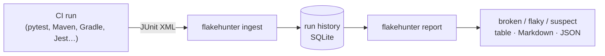

# FlakeHunter

[](https://github.com/eswar-varun/flakehunter/actions/workflows/ci.yml)

[](https://github.com/astral-sh/ruff)
[](LICENSE)

Find, rank and triage flaky tests from the JUnit XML your CI already produces.

A flaky test passes and fails on the same code. Each one teaches a team to hit "re-run"
until the build goes green, and eventually a real bug gets re-run straight into
production. FlakeHunter records every CI run, separates **flaky** tests from genuinely
**broken** ones, and ranks them by how much evidence there is, so the worst offenders get
fixed first.

> **Status: milestone 1 of 5.** Detection and ranking work. See the [roadmap](#roadmap).



## How it decides

| Status | Rule | Why |
|---|---|---|
| **broken** | failed every attempt on the latest commit it ran on | a real failure until proven otherwise |
| **flaky** | passed *and* failed on the same commit (including retries within one run) | the code didn't change, so the outcome came from timing, ordering, randomness or shared state |
| **suspect** | failed intermittently across commits, never on the same commit | weaker evidence: the code changed in between |
| **stable** | everything else, including regressions that were fixed | |

Within a status, tests are ranked by the **Wilson-score lower bound** of their failure rate,
so a test that failed once in two runs doesn't outrank one that failed 30 times in 100.
The reasoning behind every rule is in [docs/DESIGN.md](docs/DESIGN.md).

## Quickstart

```bash
pip install -e ".[dev]"

# after each CI run (any runner that writes JUnit XML)
pytest --junitxml=report.xml
flakehunter ingest report.xml --run-id "$CI_RUN_ID" --commit "$(git rev-parse HEAD)"

# whenever you want to triage
flakehunter report                    # broken, flaky and suspect tests
flakehunter report --all              # include stable ones
flakehunter report --format markdown  # for a PR comment or job summary
flakehunter report --format json
```

Sharded CI? Ingest every shard under the same `--run-id`, or pass a glob:
`flakehunter ingest "reports/*.xml"`. Re-uploading a report is harmless: ingestion is
idempotent.

### GitHub Actions

Inside Actions, `--run-id` and `--commit` default to the workflow's run id, attempt and
SHA. Each "Re-run jobs" attempt counts as a new run on the same commit, which is exactly
the evidence that confirms a flake.

```yaml
- run: pytest --junitxml=report.xml
- if: always()
  run: |
    flakehunter ingest report.xml
    flakehunter report --format markdown >> "$GITHUB_STEP_SUMMARY"
```

(Persist the history file between runs with `actions/cache` or an artifact. The AWS
backend in milestone 4 removes that step.)

## Does it work? The zoo

[`zoo/test_zoo.py`](zoo/test_zoo.py) is a suite with known ground truth: stable tests,
broken tests, and flaky tests built from the root causes seen most often in real suites
(random failures at 3%, 10% and 30%, a timing assumption, an async ordering assumption, and
an order-dependent test whose state leaks from another test). Every test's name says what it
really is, so detection can be scored exactly:

```bash
python bench/evaluate_zoo.py --runs 20 --runs-per-commit 2 --trials 5
```

This reports precision (of the tests flagged flaky, how many are), recall (of the flaky
tests, how many were flagged), how often a broken test was mislabelled as flaky, and how
many runs each flaky test took to be confirmed. CI runs a short version on every push and
posts the table to the job summary.

### Results

23 zoo tests, 2 runs per commit, mean of 5 independent trials:

| Runs so far | Precision | Recall | Broken tests labelled flaky |
|---|---|---|---|
| 4 | 100% | 47% | 0 |
| 10 | 100% | 67% | 0 |
| 20 | 100% | 83% | 0 |

Average number of runs before each flaky test was confirmed:

| Flaky test | Root cause | Confirmed after | Caught in |
|---|---|---|---|
| `async_completion_order` | assumes task completion order | 2.0 runs | 5/5 trials |
| `order_victim` | state leaked by another test | 4.4 runs | 5/5 trials |
| `random_30pct` | fails 30% of the time | 6.4 runs | 5/5 trials |
| `timing_worker_timeout` | timeout races a slow worker | 6.4 runs | 5/5 trials |
| `random_10pct` | fails 10% of the time | 12.0 runs | 4/5 trials |
| `random_3pct` | fails 3% of the time | 18.0 runs | 1/5 trials |

Nothing is ever wrongly flagged, because a test is only called flaky on direct same-commit
evidence. The cost is recall on rare flakes: a test that fails 3% of the time usually needs
more than 20 runs of history to be caught.

## Tests

```bash
pytest        # 48 tests
ruff check .
```

The parser is tested against XML produced by the real installed pytest (via `pytester`),
Maven Surefire retry output, jest-junit output, nested Gradle-style suites, and hostile
input (entity expansion, XXE). See the [test plan](docs/TEST_PLAN.md).

## Roadmap

| Milestone | Scope | Status |
|---|---|---|
| 1. Detect & rank | JUnit ingest (pytest, Surefire, Jest), history store, broken/flaky/suspect classification, Wilson ranking, CLI, ground-truth zoo + evaluation | ✅ |
| 2. Root cause: ordering | pytest plugin to replay a given test order; **delta debugging** to find the test that pollutes an order-dependent one in O(log n) reruns; quarantine that doesn't hide new failures | ⏳ |
| 3. Root cause: signatures | cluster failures by normalised stack-trace signature; GitHub Action | ⏳ |
| 4. AWS + dashboard | serverless backend (API Gateway, Lambda, DynamoDB via CDK) and a React/TypeScript dashboard | ⏳ |
| 5. Benchmarks & polish | measured results on the zoo and on a real open-source project's CI history | ⏳ |

## Docs

- [docs/DESIGN.md](docs/DESIGN.md): architecture, data model, decisions and trade-offs.
- [docs/TEST_PLAN.md](docs/TEST_PLAN.md): risks, test levels, and the case-by-case plan.
- [docs/FAQ.md](docs/FAQ.md): questions this design invites, and exercises for
  understanding it by breaking it.

## License

MIT
