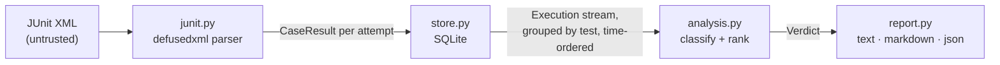
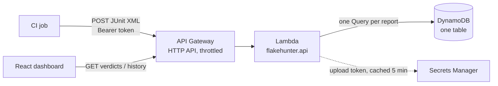

# Design

## Problem

A flaky test passes and fails without any change to the code. The costs compound:
engineers re-run builds instead of reading failures, real regressions hide among the
"probably flaky" ones, and confidence in the whole suite erodes. Fixing flakes requires
knowing *which* tests are flaky, *how* flaky, and *why*. CI systems throw that information
away after every run.

## Goals

- **Work with any language:** consume the report format every runner already writes.
- **Precision first:** a false "flaky" label trains people to ignore a real failure, which
  is worse than missing a flake. Strong labels require strong evidence.
- **Never hide a real break:** when in doubt, report a failure as broken.
- **Measured, not claimed:** detection quality is scored against ground truth (the zoo).

## Architecture

| Module | Responsibility |
|---|---|
| `junit.py` | Turn any runner's JUnit XML into one `CaseResult` per *attempt* |
| `store.py` | Persist runs and results; stream them back in analysis order |
| `analysis.py` | Classify each test from its history; rank within each status |
| `stats.py` | Wilson score interval |
| `report.py` / `cli.py` | Presentation and the command line |

## Data model

- **Run**: one CI execution of the suite against one commit (`run_id`, `commit`,
  `created_at`, `branch`).
- **CaseResult**: one attempt at one test in a run (`test_id`, `outcome`, `attempt`,
  `duration_s`, `message`). Retries within a run are separate attempts.
- **Execution**: a result joined with its run, which is what analysis consumes.
- **Verdict**: per-test status plus the counts behind it.

## Decisions

### D1. JUnit XML is the only input

pytest, Maven Surefire, Gradle, Jest (jest-junit), Go (go-junit-report), .NET and most CI
systems emit it. Supporting one format well beats integrating with each runner.
*Cost:* the format is loosely specified. The parser handles the variants that matter:
nested suites, Surefire's retry elements, and jest-junit's duplicated names.

### D2. Same-commit evidence defines "flaky"

If the commit didn't change and the outcome did, the cause is outside the code: timing,
order, randomness, shared state, the environment. That inference is close to certain, so
it gets the strong label. Retries within a run (`flakyFailure`, re-run attempts) count,
and so do separate CI runs on the same commit ("Re-run jobs").

Flips *across* commits are weaker evidence, because the change might have broken and then
fixed the test, so they get the weaker **suspect** label and don't count toward the
precision-first "flaky" set.

### D3. Broken is checked before suspect

A test with an intermittent history that fails every attempt on the newest commit is
reported **broken**, not suspect. The alternative ("it's flaky anyway") is exactly how real
regressions reach customers. The cost is some extra noise for genuinely flaky tests that
happened to fail last. That's the right side to err on, and those tests are confirmed
flaky as soon as a re-run passes.

### D4. Rank by Wilson lower bound, not raw failure rate

Raw rate puts a test that failed once in two runs (50%) above one that failed 30 times in
100 (30%), though the second is far better evidence of a real, recurring problem. The
lower bound of the 95% Wilson interval asks *"at least how often does this fail, given how
much we've seen?"* It's cheap, closed-form, behaves well at small n (unlike the normal
approximation), and needs no tuning.

### D5. Idempotent, shard-friendly ingestion

Results are keyed by `(run_id, test_id, attempt)` and written with insert-or-replace:

- uploading the same report twice changes nothing (CI steps get retried);
- several shards of one run ingest under one `run_id` and accumulate.

One guard: a `run_id` already recorded for a *different* commit is refused. Merging two
commits' results under one run would manufacture (or hide) exactly the pass/fail mix the
analysis treats as flakiness. Each report is written in one transaction, so a failed
ingest leaves nothing half-written.

### D6. Reports are untrusted input

Any job, including one from a fork's pull request, can produce a report. Parsing goes
through `defusedxml`, which rejects entity-expansion ("billion laughs") and external-entity
(XXE) payloads. Both are covered by tests. Failure messages can contain whatever a test
printed, including tokens or personal data from fixtures, so only the first 500
characters are stored and full stack traces are not kept at all. (Redaction of known secret
patterns is a candidate for milestone 3.)

### D7. Data structures and complexity

- **Store → analysis is a stream.** The query returns rows ordered by
  `(test_id, created_at, run_id, attempt)`, and analysis consumes them with
  `itertools.groupby`, holding one test's history at a time: O(n) time over n executions
  and O(h) memory for the longest single history h, instead of O(n) memory for everything.
- **Per-commit counts use a dict.** One O(1) update per execution, and insertion order
  doubles as "first seen" order. Sorting by commit would cost O(h log h) and lose
  chronology.
- **The grouping precondition is checked, not trusted.** A test id reappearing after its
  group ended means the input wasn't sorted, which would silently split a history into two
  verdicts. A set of finished ids catches it in O(1) per group.
- **Index choice.** `results(test_id)` serves the per-test scan; `runs(commit_sha)`
  serves commit lookups. The primary key `(run_id, test_id, attempt)` makes re-ingest an
  index lookup.

The DynamoDB store (D9) serves the same access pattern with its key design instead of
indexes.

### D8. Reports show what needs a human

Default output is broken, then flaky, then suspect. Stable and skipped tests appear only with
`--all`. The Markdown output escapes `|` in test ids, since parametrised ids such as
`test[a|b]` would otherwise break the table.

## Serverless backend (milestone 4)

The Lambda runs the same parser and the same `analyze()` as the CLI; only the store
changes. Infrastructure is a CDK app in `infra/`, and `dev/local_api.py` runs the real
handler against an in-memory DynamoDB (moto) for local development.

### D9. DynamoDB keys follow the analysis order

One table, one partition per project:

| Item | `pk` | `sk` |
|---|---|---|
| result | `PROJECT#<project>` | `RESULT#<test_id>␟<created_at>␟<run_id>␟<attempt>` |
| run | `PROJECT#<project>` | `RUN#<run_id>` |

(␟ is U+001F, the ASCII unit separator.)

- **A report is one paginated Query.** Items come back sorted by `sk`, which is exactly
  "grouped by test, time-ordered within each test", so they stream straight into
  `analyze()` as the SQLite rows do: O(n) reads, O(h) memory.
- **One test's history** is `begins_with(sk, "RESULT#<test_id>␟")`. The separator can't
  occur in a test id (XML 1.0 forbids it), so the prefix is exact: `t::a` doesn't match
  `t::ab` or `t::a[1]`. With `#` as the separator it would, since parametrised ids contain
  `#`. A test checks this.
- **Why not `pk = test_id`** (the plan before this milestone)? A report needs every test,
  and with one partition per test that means a table scan or a second index just to list
  the tests. Per-project partitions answer both access patterns with one key design.
- **Cost of that choice:** a project is one partition, and DynamoDB caps one partition at
  about 1,000 writes and 3,000 reads per second. CI uploads are far below that. A project
  that outgrew it would shard the partition key (`PROJECT#
#<n>`) and merge the sorted
  streams.

### D10. Idempotency without one big transaction

SQLite writes a report in one transaction. DynamoDB transactions hold at most 100 items,
and reports are often bigger, so the guarantees are rebuilt differently:

- **Claim the run first.** One conditional `UpdateItem` records the run's commit and time,
  or confirms they match: `attribute_not_exists(pk) OR commit_sha = :commit`. Claim and check
  are one atomic step, so two concurrent uploads that reuse a run id for different commits
  can't both succeed. The loser gets HTTP 409.
- **Keys are deterministic.** A result's key is built from the run's *recorded* time (the
  claim returns it), not the request's. A retried upload stamped "now" therefore lands on
  the same keys and overwrites instead of double-counting.
- **Never split a test.** Results are written in `TransactWriteItems` batches of at most 100
  that keep all attempts of one test together. A crash between batches can leave some
  tests recorded and others not: each recorded result is still a true observation, and
  the retry fills in the rest. But it can't leave a failed first attempt visible without
  the retry that passed, which would briefly turn a flaky test into a "broken" one.
- **Duplicates inside one report** (the same test listed twice) are collapsed, last one
  wins, as SQLite's `INSERT OR REPLACE` does. A transaction would otherwise refuse two writes
  to one item.

Transactional writes cost twice the write units of plain ones. At CI volumes that's
cents, and it buys the "never split a test" guarantee.

### D11. API surface and security

| Route | Auth | Purpose |
|---|---|---|
| `POST /projects/{project}/runs?run_id=&commit=` | bearer token | upload one report (body: JUnit XML) |
| `GET /projects/{project}/verdicts[?all=true]` | none | the triage list, ranked |
| `GET /projects/{project}/history?test_id=` | none | one test's executions and verdict |

- **Uploads need a token; reads don't.** Reads expose test names and outcomes, the same as
  a public CI log. Writes could poison history, so they need a token. The token is generated
  by Secrets Manager, compared in constant time (`hmac.compare_digest`), and cached in the
  function for 5 minutes, so a rotated token takes effect without a deploy.
- **Untrusted input stays untrusted:** the same defusedxml parser, a 4 MB body limit checked
  before parsing (Lambda's synchronous payload limit is 6 MB), and validated project and
  run names.
- **Errors map to status codes:** a bad report or parameters gives 400, a bad token 401,
  a run/commit conflict 409, an oversized body 413. Anything unexpected gives a 500 that says
  only "internal error"; the traceback goes to CloudWatch.
- **One JSON log line per request** (request id, route, project, status, duration) makes
  CloudWatch Logs Insights queries straightforward.
- **Least privilege:** the function can read and write items in its table and read its
  secret. It can't delete or reconfigure the table, and a test asserts that on the
  synthesized template.
- **Cost guard rails:** on-demand billing (nothing to pay when idle), throttling on the API
  stage (10 requests/s, bursts of 20), 2-week log retention, and a retained table so
  `cdk destroy` never deletes history.

### D12. Dashboard

React and TypeScript with no UI library, built test-first with Vitest and React Testing
Library. Each feature's tests were written and seen failing before the code. The tests
query by role and label, the way a user finds things, so they also check accessibility
basics.

- **The API's ranking is the order.** The table filters (by status chip and by test name)
  but never re-sorts, so "most urgent first" is decided in one place: `analyze()`.
- **Stale responses are dropped.** Switching project or toggling "Show stable tests" aborts
  the previous request. The response is also ignored if it still arrives, which a test
  covers with a deliberately slow promise.
- **Test ids go in a query parameter,** never the path: they contain `/`, `::`, `[a|b]`
  and `#`.
- **The project is in the URL** (`?project=`), so a link opens the dashboard on it.

## Known limitations

- **Renamed tests lose their history:** identity is the test id.
- **Test ids containing random values** (e.g. parametrised with timestamps) look like new
  tests every run.
- **No source awareness:** for "suspect", FlakeHunter can't tell whether the test itself
  changed between commits.
- **Every report reads the whole history.** That's O(n) per request. Fine for months of
  CI on one service; beyond that, keep a time window or maintain verdicts incrementally
  from a DynamoDB stream.
- **Eventually consistent reads:** a report fetched within a second of an upload may not
  include it yet.
