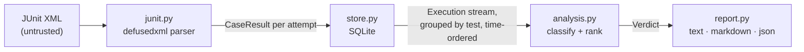

# Design

## Problem

A flaky test passes and fails without any change to the code. The costs compound:
engineers re-run builds instead of reading failures, real regressions hide among the
"probably flaky" ones, and confidence in the whole suite erodes. Fixing flakes requires
knowing *which* tests are flaky, *how* flaky, and *why*. CI systems throw that information
away after every run.

## Goals

- **Work with any language:** consume the report format every runner already writes.
- **Precision first:** a false "flaky" label trains people to ignore a real failure, which
  is worse than missing a flake. Strong labels require strong evidence.
- **Never hide a real break:** when in doubt, report a failure as broken.
- **Measured, not claimed:** detection quality is scored against ground truth (the zoo).

## Architecture

| Module | Responsibility |
|---|---|
| `junit.py` | Turn any runner's JUnit XML into one `CaseResult` per *attempt* |
| `store.py` | Persist runs and results; stream them back in analysis order |
| `analysis.py` | Classify each test from its history; rank within each status |
| `stats.py` | Wilson score interval |
| `report.py` / `cli.py` | Presentation and the command line |

## Data model

- **Run**: one CI execution of the suite against one commit (`run_id`, `commit`,
  `created_at`, `branch`).
- **CaseResult**: one attempt at one test in a run (`test_id`, `outcome`, `attempt`,
  `duration_s`, `message`). Retries within a run are separate attempts.
- **Execution**: a result joined with its run, which is what analysis consumes.
- **Verdict**: per-test status plus the counts behind it.

## Decisions

### D1. JUnit XML is the only input

pytest, Maven Surefire, Gradle, Jest (jest-junit), Go (go-junit-report), .NET and most CI
systems emit it. Supporting one format well beats integrating with each runner.
*Cost:* the format is loosely specified. The parser handles the variants that matter:
nested suites, Surefire's retry elements, and jest-junit's duplicated names.

### D2. Same-commit evidence defines "flaky"

If the commit didn't change and the outcome did, the cause is outside the code: timing,
order, randomness, shared state, the environment. That inference is close to certain, so
it gets the strong label. Retries within a run (`flakyFailure`, re-run attempts) count,
and so do separate CI runs on the same commit ("Re-run jobs").

Flips *across* commits are weaker evidence, because the change might have broken and then
fixed the test, so they get the weaker **suspect** label and don't count toward the
precision-first "flaky" set.

### D3. Broken is checked before suspect

A test with an intermittent history that fails every attempt on the newest commit is
reported **broken**, not suspect. The alternative ("it's flaky anyway") is exactly how real
regressions reach customers. The cost is some extra noise for genuinely flaky tests that
happened to fail last. That's the right side to err on, and those tests are confirmed
flaky as soon as a re-run passes.

### D4. Rank by Wilson lower bound, not raw failure rate

Raw rate puts a test that failed once in two runs (50%) above one that failed 30 times in
100 (30%), though the second is far better evidence of a real, recurring problem. The
lower bound of the 95% Wilson interval asks *"at least how often does this fail, given how
much we've seen?"* It's cheap, closed-form, behaves well at small n (unlike the normal
approximation), and needs no tuning.

### D5. Idempotent, shard-friendly ingestion

Results are keyed by `(run_id, test_id, attempt)` and written with insert-or-replace:

- uploading the same report twice changes nothing (CI steps get retried);
- several shards of one run ingest under one `run_id` and accumulate.

One guard: a `run_id` already recorded for a *different* commit is refused. Merging two
commits' results under one run would manufacture (or hide) exactly the pass/fail mix the
analysis treats as flakiness. Each report is written in one transaction, so a failed
ingest leaves nothing half-written.

### D6. Reports are untrusted input

Any job, including one from a fork's pull request, can produce a report. Parsing goes
through `defusedxml`, which rejects entity-expansion ("billion laughs") and external-entity
(XXE) payloads. Both are covered by tests. Failure messages can contain whatever a test
printed, including tokens or personal data from fixtures, so only the first 500
characters are stored and full stack traces are not kept at all. (Redaction of known secret
patterns is a candidate for milestone 3.)

### D7. Data structures and complexity

- **Store → analysis is a stream.** The query returns rows ordered by
  `(test_id, created_at, run_id, attempt)`, and analysis consumes them with
  `itertools.groupby`, holding one test's history at a time: O(n) time over n executions
  and O(h) memory for the longest single history h, instead of O(n) memory for everything.
- **Per-commit counts use a dict.** One O(1) update per execution, and insertion order
  doubles as "first seen" order. Sorting by commit would cost O(h log h) and lose
  chronology.
- **The grouping precondition is checked, not trusted.** A test id reappearing after its
  group ended means the input wasn't sorted, which would silently split a history into two
  verdicts. A set of finished ids catches it in O(1) per group.
- **Index choice.** `results(test_id)` serves the per-test scan; `runs(commit_sha)`
  serves commit lookups. The primary key `(run_id, test_id, attempt)` makes re-ingest an
  index lookup.

The DynamoDB design for milestone 4 follows the same access pattern: partition key
`test_id`, sort key `created_at#run_id#attempt`, so one query returns a test's history
in order.

### D8. Reports show what needs a human

Default output is broken, then flaky, then suspect. Stable and skipped tests appear only with
`--all`. The Markdown output escapes `|` in test ids, since parametrised ids such as
`test[a|b]` would otherwise break the table.

## Known limitations (milestone 1)

- **Renamed tests lose their history:** identity is the test id.
- **Test ids containing random values** (e.g. parametrised with timestamps) look like new
  tests every run.
- **No source awareness:** for "suspect", FlakeHunter can't tell whether the test itself
  changed between commits.
- **History is a local SQLite file:** CI needs to persist it until the AWS backend lands.
